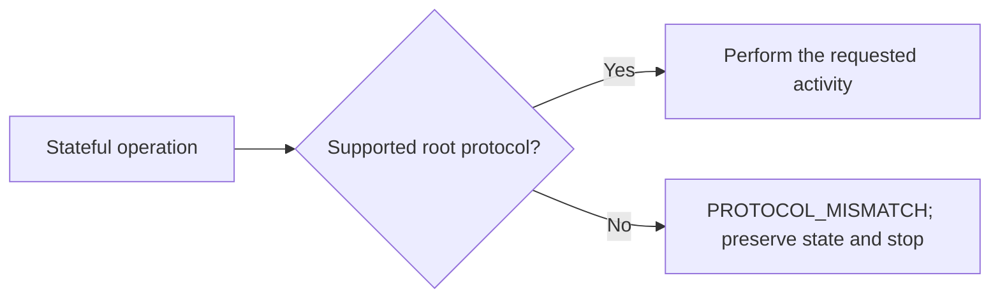
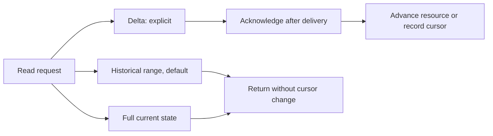
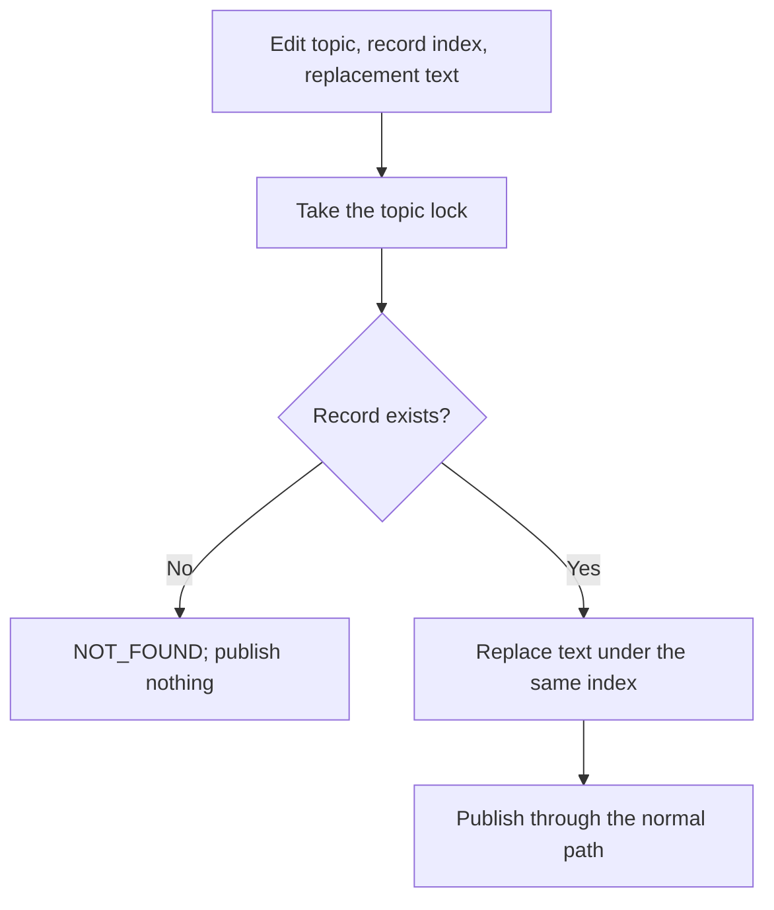
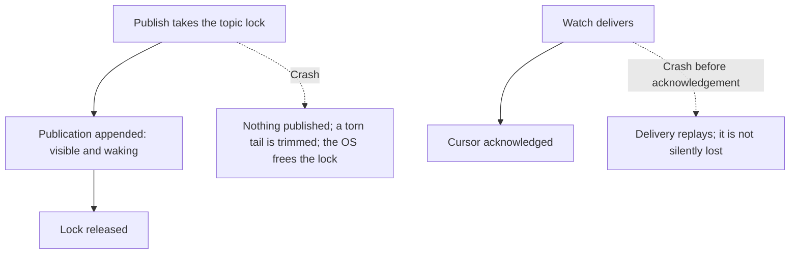

# Conductor activity diagrams

These diagrams cover the agent-visible lifecycle and the ordering that matters during normal work, contention, and crashes. Storage details are defined by the [protocol reference](../skills/conductor/references/protocol.md).

## Happy path

Every stateful path first crosses the same compatibility gate:

```mermaid
sequenceDiagram
    actor User
    participant A as "Joining agent"
    participant C as "Conductor client"
    participant D as "Disk state"
    participant W as "Wake owner"
    participant B as "Other registered agent"

    User->>A: "Join with name and responsibility"
    A->>C: "register"
    C->>D: "Take the membership lock and write registry entry"
    C->>D: "Publish the roster line on collaboration/agents"
    D-->>C: "Roster and complete current snapshot"
    C-->>A: "Agents and published records"
    W->>C: "watch"
    C-->>W: "Roster line delta"
    W-->>B: "Deliver"

    alt "One record"
        A->>C: "put topic text"
    else "Many records, one publication"
        A->>C: "put topic --jsonl=path"
    end

    C->>D: "Take the topic lock, append to history, release"
    C-->>A: "Resulting records and recipients"

    W->>C: "watch"
    C->>D: "Read deltas of grown topics after B's cursors"
    C-->>W: "Capped delivery batch plus remaining"
    W-->>B: "Deliver"
    W->>C: "Acknowledge after the host accepts"
    C->>D: "Advance B's cursors"

    A->>C: "leave"
    C->>D: "Strike the roster line, remove registry entry"
    W->>C: "watch"
    C-->>W: "Struck roster line delta"
    W-->>B: "Deliver"
```

The wake owner is either the receiving agent or a harness adapter acting for it.

The alternative read modes do not move the delta cursor:

Editing a record preserves its identity:

## Contention and crashes

Operations on one topic serialize on its OS file lock; a waiter blocks, and returns `TIMEOUT` only if the lock stays held past the client's lock timeout. Join and leave serialize on one membership lock. The operating system releases every lock of a process that exits, so a crash never strands a topic.

