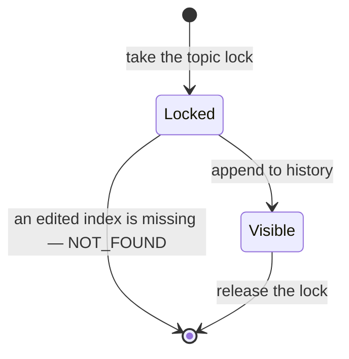

# State model

Conductor's files are coordination state, not a log of an in-memory service. Each operation reads that state, advances it through a guarded transition, and leaves enough evidence for the next operation to continue.

The root `protocol.json` is the compatibility gate for all of that state. Opening a root that has none declares it, by linking a complete file into place, before constructing operational directories; every public stateful operation revalidates it. A missing, malformed, or unsupported declaration then fails; nothing migrates.

## Stable identities

An **agent** is a registered name and responsibility. Every CLI call names it explicitly as its leading argument. A binding is not membership: every operation still requires the registry entry to exist.

A **resource** is a `<topic-group>/<topic>` name. A **record** is exactly a positive topic-local `index` and plain `text`. Conductor assigns the index when creating the record, as the topic's highest index plus one; edit preserves it. One publication may change several records, but only within one resource.

A publication's **sequence** orders it within its topic: one more than the topic's last. It is unrelated to record indexes, and nothing orders publications across topics. Timestamps describe; they do not order.

## Membership

Membership follows a short path:

```text
unregistered -> registered -> departed
```

Registration validates the identity, serializes against membership changes, writes the registry entry, publishes the `name: responsibility` line on `collaboration/agents`, and returns the current roster and published state. Repeating the same name and responsibility is idempotent, and publishes the line only if it is missing. Reusing the name with a different responsibility is rejected.

Departure edits that line to struck-through text, then removes the registry entry and subscriptions. Prior publications remain. The roster line is the whole join and leave announcement: every agent reads `collaboration/agents`, so peers are woken by it like any publication.

## Publication

A publication is one call, made under an OS file lock on its topic:



Under the lock Conductor reads the topic's history, gives each new record the highest index plus one, checks that every edited index exists, resolves the recipients, and appends the publication to `history.jsonl` with the topic's next sequence. The append is the visibility boundary and the wake: readers take the same lock, so they see the whole publication or none of it, and a watcher finds it there. A `--jsonl` load is one publication carrying many records. The operating system releases the lock of a dead process, so a crash never strands a topic.

The publishing act answers with the publication and its recipients. A publisher that only got its own record back could not tell a topic somebody reads from one nobody is subscribed to; both succeed, and the difference is a delivery that never happens. The answer is who will be woken, not who is subscribed — an agent is not an addressee of its own act, so the publisher is absent from it even on a topic it subscribes to. The set is not written to history: the next subscription change falsifies it.

## Reading and delivery

Three read views share the same published history:

- **Delta** returns other agents' publications after the accepted topic or record cursor.
- **Historical** returns an inclusive index range without moving that cursor.
- **Full** reconstructs the current records from history without moving that cursor.

A watch polls the topics its agent reads — the two broadcast topics, its subscriptions, and every topic in its subscribed groups — and reads a delta of each whose history grew. It returns the unread deltas as one batch up to a shared record cap; `remaining` counts what was left for the next call. Acknowledgement advances each delivered cursor past every publication the delta scanned, the agent's own included. Subscribing starts the new topics' cursors at their current heads, so a subscription is never retroactive.

## Locking

Every read and write of a topic takes that topic's OS file lock, so operations on one topic run one at a time and a waiter blocks until the lock is free, returning `TIMEOUT` only after the client's lock timeout. Join and leave share one membership lock. All of these are released by the operating system when their holder exits, crashed or not, so there is no lease and nothing to recover.

## Authority on disk

| Concern | Authority | Derived or delivery state |
| --- | --- | --- |
| State compatibility | Root protocol declaration | Installer and version metadata |
| Membership | Registry entries | Terminal session bindings |
| Published value | Append-only topic history | None |
| Record identity | Highest index in topic history | None |
| Publication order | Sequence in topic history | Timestamps |
| Accepted progress | Cursor | None |

Nothing is derived from history except the cursor, so there is nothing to repair.

## Upgrades

There is no live replacement and no migration. An upgrade stops every agent, replaces the installed trees, and restarts; a protocol change also starts a fresh state root. The [update procedure](../../skills/conductor/references/update-skill.md) carries the steps.

Exact file ordering and crash windows belong to the [protocol reference](../../skills/conductor/references/protocol.md). The [architecture](architecture.md) explains why these states exist; [runtime boundaries](runtime-boundaries.md) define when delivery leaves Conductor's responsibility.
