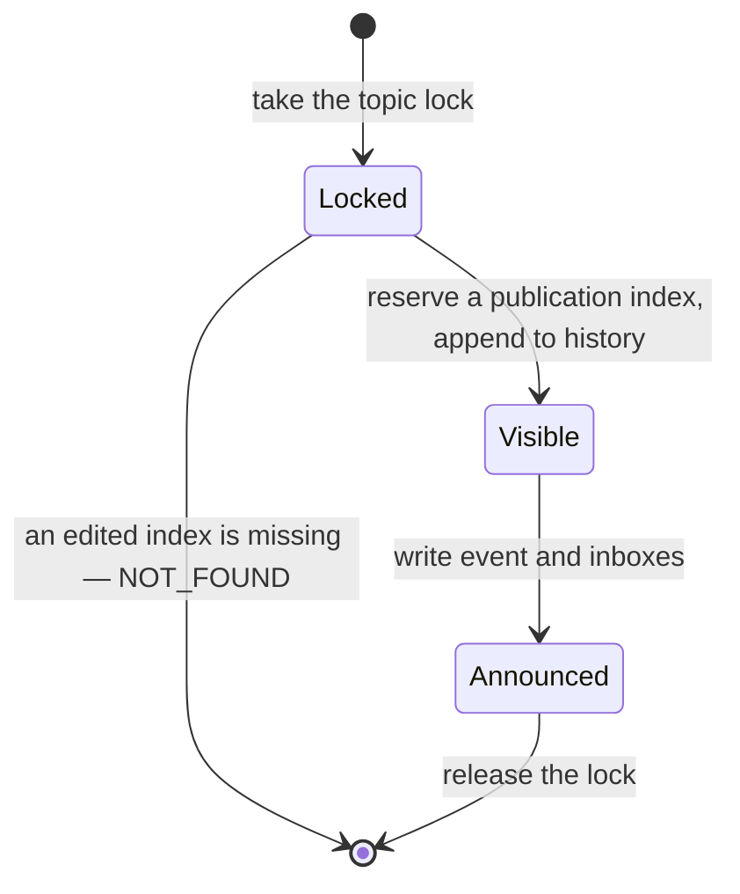

# State model

Conductor's files are coordination state, not a log of an in-memory service. Each operation reads that state, advances it through a guarded transition, and leaves enough evidence for the next operation to continue.

The root `protocol.json` is the compatibility gate for all of that state. Conductor creates it only for an empty root, validates it before constructing operational directories, and revalidates it at every public stateful operation. A nonempty unversioned root and a missing, malformed, or unsupported declaration fail; nothing migrates.

## Stable identities

An **agent** is a registered name and responsibility. A terminal binding associates that name with one process instance; an SDK caller may supply identity explicitly. A binding is not membership: every operation still requires the registry entry to exist.

A **resource** is a `<topic-group>/<topic>` name. A **record** is exactly a positive topic-local `index` and plain `text`. Conductor assigns the index when creating the record, as the topic's highest index plus one; edit preserves it. One publication may change several records, but only within one resource.

A **publication index** identifies global reservation order. Completion may occur out of order across topics, and a crash may leave a gap. Timestamps describe events; they do not order publications or signal delivery.

## Membership

Membership follows a short path:

```text
unregistered -> registered -> departed
```

Registration validates the identity, serializes against membership changes, writes the registry entry, returns the current roster and published state, and creates a self-inclusive `join` signal. Repeating the same name and responsibility is idempotent. Reusing the name with a different responsibility is rejected.

Departure removes the registry entry, edits the agent's `collaboration/agents` record to struck-through text, and creates a `leave` signal. Prior publications remain; future signals exclude the departed agent.

## Publication

A publication is one call, made under an OS file lock on its topic:



Under the lock Conductor reads the topic's history, gives each new record the highest index plus one, checks that every edited index exists, takes the next publication index, and appends the publication to `history.jsonl`. The append is the visibility boundary: readers take the same lock, so they see the whole publication or none of it. A `--jsonl` load is one publication carrying many records.

Conductor then writes an event and appends signals to recipient inboxes. A crash between the append and the event leaves a publication that is readable but that nobody was woken for; there is no recovery step. The operating system releases the lock of a dead process, so a crash never strands a topic.

Announced is also where the recipient set becomes known, and it is what the publishing act answers with alongside the publication it made. A publisher that only got its own record back could not tell a topic somebody reads from one nobody is subscribed to; both succeed, and the difference is a delivery that never happens. The answer is who was woken, not who is subscribed — an agent is not an addressee of its own act, so the publisher is absent from it even on a topic it subscribes to, and an agent alone on a topic reads an empty audience rather than its own name. The set is not written to history: it is true of the instant it was resolved and the next subscription change falsifies it, so history stores the publication and the answer carries the audience.

## Reading and delivery

Three read views share the same published history:

- **Delta** returns changes after the accepted resource-wide or record-specific cursor.
- **Historical** returns an inclusive index range without moving that cursor.
- **Full** reconstructs the current records from history without moving that cursor.

A signal is a location hint outside the record model. One watch discovers the current unread summaries and resolves them into a delivery batch up to the shared record cap; `remaining` counts summaries left pending for the next call. Explicit acknowledgement advances only the summaries and topic content actually delivered. Compact acknowledged ranges preserve a late lower publication index even when a higher one finished first.

The SDK-only `WatchSinceContext(ctx, N)` operation is different. It records an intentional discard floor through `N`; a late signal at or below that index remains discarded.

## Locking

Every read and write of a topic takes that topic's OS file lock, so operations on one topic run one at a time and a waiter blocks until the lock is free, returning `TIMEOUT` only after the client's lock timeout. Join and leave share one membership lock. All of these are released by the operating system when their holder exits, crashed or not, so there is no lease and nothing to recover.

## Authority on disk

| Concern | Authority | Derived or delivery state |
| --- | --- | --- |
| State compatibility | Root protocol declaration | Installer and version metadata |
| Membership | Registry entries | Terminal session bindings |
| Published value | Append-only topic history | None |
| Record identity | Highest index in topic history | None |
| Created signal | Event with its recipient set | Per-agent inbox entry |
| Accepted progress | Cursor | None |
| Publication order | Global next-index state | Timestamps |

These distinctions make repair bounded. A missing inbox append is reconciled from its event, and that repair never changes the publication itself.

## Upgrades

There is no live replacement and no migration. An upgrade stops every agent, replaces the installed trees, and restarts; a protocol change also starts a fresh state root. The [update procedure](../../skills/conductor/references/update-skill.md) carries the steps.

Exact file ordering and crash windows belong to the [protocol reference](../../skills/conductor/references/protocol.md). The [architecture](architecture.md) explains why these states exist; [runtime boundaries](runtime-boundaries.md) define when delivery leaves Conductor's responsibility.
