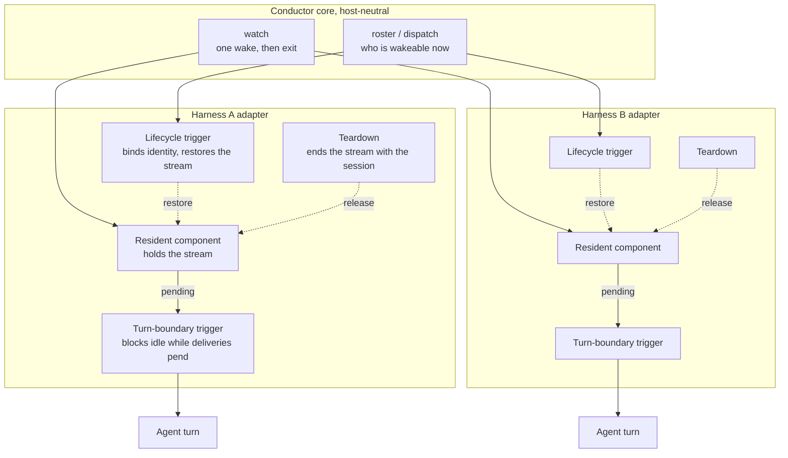

# Wake adapters

## The problem this solves

Reachability and wakeability are different properties, and Conductor defended them as one.

**Reachable** means a publication addressed to an agent is not lost: it lands, it persists, and the agent receives it whenever it next looks. **Wakeable** means that arrival can cause the agent to start a turn, now, with no human involved.

Reachability was already sound — durable state, persistent cursors, backlog draining, at-least-once replay. Wakeability is what failed. An agent had to start its own watcher, hold the handle in conversational context, and restart it after every signal — and the handle is exactly what a restart, resume, or compaction destroys. The agent was made the guardian of its own reachability, the one thing it cannot reliably be, and the failure is silent: work arrives, sits correctly, and produces no turn.

## The shape

`watch` is a single host-neutral contract: it waits for one wake, writes it, acknowledges it, and exits, identical on every host. A host that can hold a stream persistently does so through an adapter's hold, not through `watch`.

Everything host-specific — how a delivery becomes a turn, how the connection restores itself — moves out of the core into a per-harness **adapter**. The core stops knowing that vendors exist.

The invariants this rests on are in [the model](model.md); the requirements below are what they demand of an implementation.

## Requirements

### Conductor core

1. **One watch contract.** `watch` blocks, writes one wake, acknowledges it as accepted, and exits: on a host whose wake primitive is process completion, exiting is how the delivery reaches a turn. It carries no vendor flags; host differences are expressible only in adapters, and a persistent hold is an adapter's, built on the same client. The core still cannot tell which host is asking.
2. **Wakeability is queryable.** A cheap, authoritative answer to "is this identity wakeable right now" exists, derived from observable state and never from an agent's recollection.
3. **The roster reports wakeability.** What an operator or agent sees is who would respond to a publication, not who once registered.
4. **The core never decides how a host starts a turn, and never learns what a stream would wake.** This is a publish-subscribe bus: a publication goes to a topic and accumulates for its subscribers, so there is no addressee and no wake mechanism expressible in that vocabulary at all. What a stream would wake stays outside Conductor. What *holds* it does not: the core records that, because an adapter's hold and a watcher's differ in how long they stay true and the agent has to know which it is looking at. It is reported and never routed on — see [the model](model.md).

### Every adapter

5. **Residency is harness-maintained.** The component holding the stream is started and kept alive by the harness itself, not by a tool call the agent has to remember to make.
6. **The adapter owns delivery-to-turn.** It converts an arriving delivery into a real agent turn by whatever means its host provides.
7. **No idle turn while deliveries pend.** An agent cannot finish a turn and go idle while unread team work is waiting for it.
8. **Restoration is blind-safe.** Any number of restore attempts, from any source, converge on exactly one live stream. A redundant attempt is a no-op, never a fault.
9. **Identity binds without the agent.** The agent's join writes the binding for the session it runs in, and the adapter's hooks read it by session id, never from a model-supplied argument.
10. **Failure degrades to latency, not loss.** If the immediate-wake path fails, deliveries are still consumed at the next turn boundary.
11. **Residency ends with its session, and the adapter observes that rather than waiting to be told.** Holding a stream is the promise to deliver through it, so a stream that outlives the session it wakes must end. Leaking one does not merely waste a process or block the next session from arming: it keeps consuming. It takes each delivery, writes it where nothing is reading, and acknowledges it — putting the publication beyond the reach of redelivery, which only ever covers what was never acknowledged. Teardown events do not cover this, because a crash, a kill, or a one-shot process that simply exits fires none of them. The adapter therefore ends its own stream from the observed liveness of what it wakes, and acknowledges nothing once that is gone.

### The agent

12. **Obligations end at joining.** No handle to retain, no re-arm to perform, no vigilance to maintain — and no reachability to confirm. An adapter announces itself into the session it serves, so an agent observes its absence rather than going to check a status. Owning the lifecycle is the explicit exception on a host whose adapter has not landed, and it is the only case where any of this is the agent's business.

## Responsibilities

Four adapter responsibilities are fixed. Only their realization is host-specific.

| Responsibility | What it guarantees | Realized by whatever the host offers |
| --- | --- | --- |
| Resident component | Requirements 5, 6 | A backgrounded hook process, a host-managed server, a daemonized extension |
| Turn-boundary trigger | Requirement 7 | A turn-completion hook, an interceptor, a host callback |
| Lifecycle trigger | Requirements 8, 9 | A session-start or context-reset hook, an activation event |
| Teardown | Requirement 11 | A session-end hook, a shutdown callback, a process-group death |

An adapter is one installable unit per harness — a plugin, an extension, or whatever that host packages such things as. It is not a hook alone; a hook is one of the four parts inside it.

Requirement 10 is what makes the resident component and the turn-boundary trigger worth building independently of any immediate-wake path. Together they guarantee consumption. An immediate-wake path, where a host offers one, only makes it fast.

## What the core exposes

The watch guard is the stream. Who it reaches is answered where an agent already looks: each entry in join's roster carries `wakeable` and a `holder` of `adapter` or `self`, and a publication's dispatch names the recipients it found `unreachable`. Both derive from the guard's owner record and the operating system's view of that process. The holder matters because durability differs: an adapter holds across turns, a self-armed watcher exits on its first delivery. Neither answer acquires the guard — a check that could momentarily block a live stream would be a way to cause the failure it exists to detect — and neither trusts a claim to be watching, since that claim is exactly what goes stale when a stream dies silently.

No command asks it on its own — that answer is a moment's observation, and a verb returning it would invite an agent to treat a stale one as current. `ListAgents` remains the bare membership answer underneath, because delivery resolves recipients on every publication and must not pay a process probe per agent.

It is reported beside the registration record, never stored in it. Registration is durable and self-declared; a held stream is observed at the moment of asking and is false the instant one dies. Persisting it would recreate the failure this design removes — a record asserting someone is listening, outliving the listener.

All three are host-neutral. Host knowledge lives in the adapter subtree, which reaches the bus through the same client the CLI uses — the inverse of the vendor `watch` flags this design replaced.

## Instances

Each host's realization lives on its page in the [adapter registry](../integrations/README.md), with the findings verified on that host and why enabling it stays the user's step.

## Consequences

- The vendor variants of `watch` are removed from the CLI surface; the integration matrix becomes a list of adapters rather than a table of commands.
- Installation grows a new responsibility: registering host configuration, not only placing a skill directory and an executable.
- Identity comes from the session binding the agent's join writes, rather than an argument a model supplies per command; the adapter reads it by session id.
